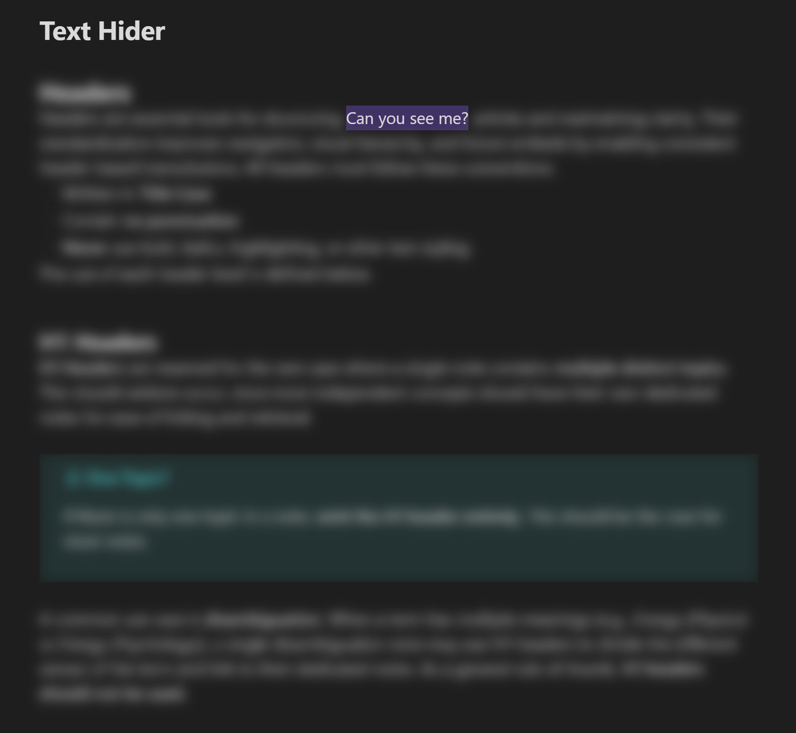
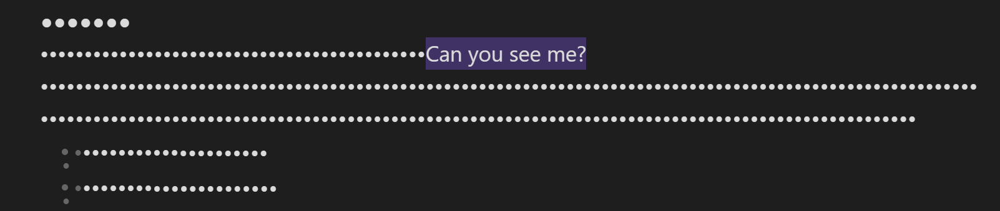
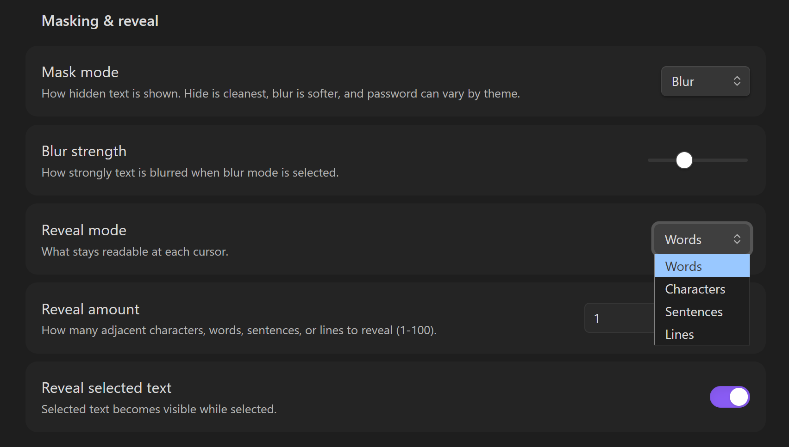
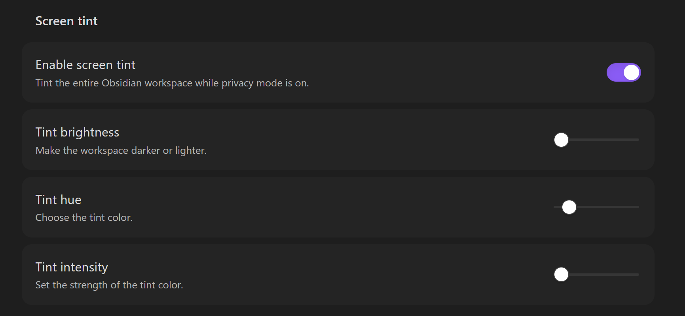
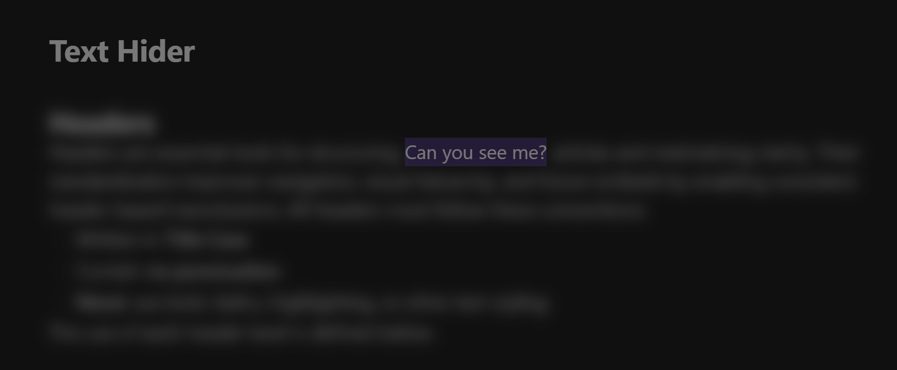

# Text Hider

**Text Hider** is an Obsidian plugin that visually masks note content while you edit or read it. It is useful for working in public without exposing your writing to people nearby.

---

## Features

- Toggle privacy mode from the Command Palette, a hotkey, or the status-bar indicator.
- Mask notes in both the editor and Reading View without changing the underlying Markdown files.
- Choose one of three masking styles:
  - **Hide** — completely removes text from view while retaining the layout.

    

  - **Blur** — obscures text while preserving its visual shape and layout.

    

  - **Password** — displays bullet-style masking; its appearance can vary by theme.

    

- Reveal only the text around each cursor. Choose characters, words, sentences, or lines, then set how many adjacent units to reveal.
- Optionally reveal selected text while it is selected.
- Control how the inline note title, Markdown headers, and callouts are handled: keep them visible, mask them, or hide them completely.
- Add an optional transparent screen tint while privacy mode is enabled. Adjust its brightness, hue, and color intensity.

---

## Settings

### Masking and reveal

Select a mask style, choose what the cursor reveals, and set the reveal amount. Blur strength is shown only when **Blur** mode is selected.

### Exceptions and behavior

Each of the following can be set to **Keep visible**, **Mask text**, or **Hide completely**:

- Inline note title
- Markdown headers (`#`, `##`, `###`, and so on)
- Markdown callouts

By default, Text Hider keeps note titles visible and masks headers and callouts.

### Reveal selected text

When enabled, selected text becomes visible while it is selected.

### Screen tint

Enable a transparent workspace overlay while privacy mode is active. **Tint brightness** darkens or lightens the workspace, while **Tint hue** and **Tint intensity** add a color tint. The overlay always remains transparent and is displayed behind Obsidian settings dialogs.

---

## Commands and hotkeys

Text Hider provides these Command Palette actions:

- **Toggle privacy mode**
- **Enable privacy mode**
- **Disable privacy mode**
- **Set mask mode to hide**
- **Set mask mode to blur**
- **Set mask mode to password**

You can assign a different hotkey to each command:

1. Open **Settings → Hotkeys**.
2. Search for **Text Hider**.
3. Assign your preferred keybinding.

---

## Notes and limitations

- Text Hider works at the display level in the editor and Reading View.
- It does not change, encrypt, or write to note files.
- Images and other media remain unchanged.
- Themes can slightly affect the appearance of blur and password masking.

Turn privacy mode off at any time to show your notes normally.

---

## Development status

Text Hider is under active development. Feedback, bug reports, and suggestions are welcome.

---

## License

ISC