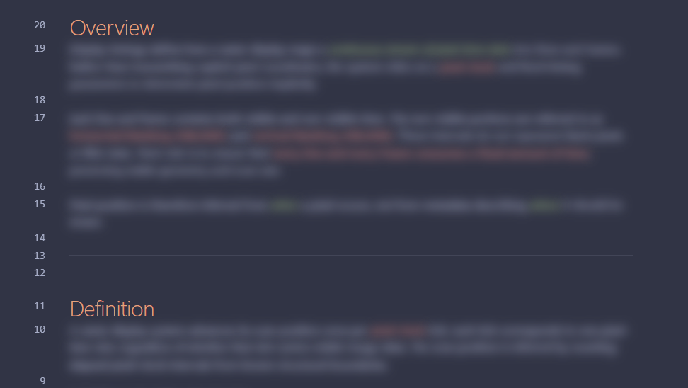
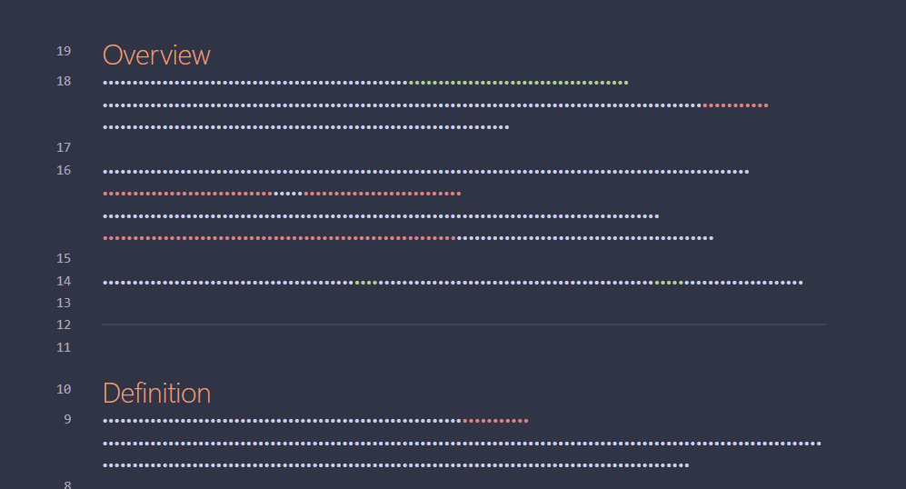
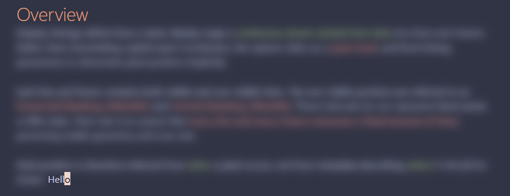
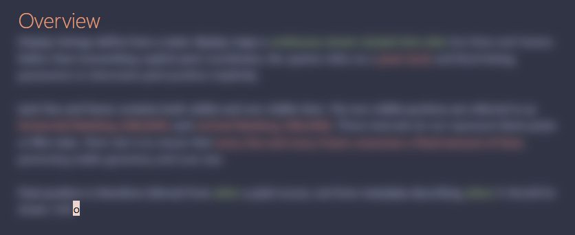
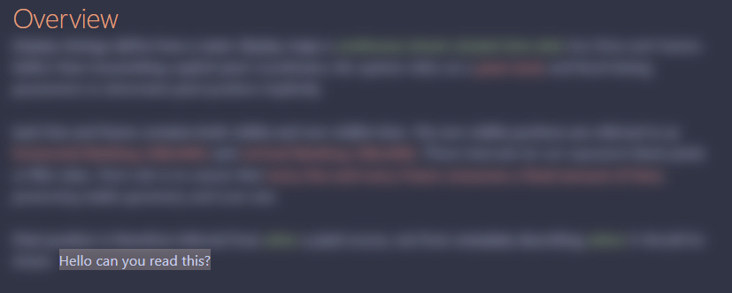

# Text Hider

**Text Hider** is an Obsidian plugin that visually hides note content while you edit or read it in public. It only changes what is displayed: notes are never changed, encrypted, or written to disk differently.

<p>
  
  
  
</p>

<p>
  
  
  
</p>

## Features

- Toggleable text masking with Hide, Blur, and Password modes
- Adjustable blur strength
- Reveal the current word or letter at every cursor
- Optionally reveal each cursor's entire current line
- Optionally reveal selected text
- Keep Markdown headers visible
- Mask rendered text in Reading View
- Optional, clickable status bar indicator

## Settings

### Mask mode

Choose how hidden text is displayed:

- **Hide**: completely invisible while preserving layout.
- **Blur**: obscures text while preserving structure. Use **Blur strength** to control the effect.
- **Password**: bullet-style masking. Appearance can vary by theme.

### Reveal behavior

Choose whether the current word or current letter remains readable at each cursor. You can also reveal all selected text or each cursor's entire current line.

### Views and status

**Mask Reading View** protects rendered Markdown text as well as Live Preview and Source mode. Images and other media remain unchanged. **Show status bar indicator** adds an on/off indicator that can be selected to toggle the plugin.

## Commands and hotkeys

Text Hider provides three commands:

- **Toggle privacy mode**
- **Enable privacy mode**
- **Disable privacy mode**

Bind a hotkey in **Settings -> Hotkeys** or use the Command Palette. When the status bar indicator is enabled, selecting it also toggles privacy mode.

## Notes and limitations

- Text Hider runs entirely locally and makes no network requests.
- Reading View masking wraps rendered text only while privacy mode is enabled. It does not alter the note source.
- Some themes may slightly affect blur or password masking appearance.

## Development

```bash
npm install
npm test
npm run lint
npm run build
```

## License

0BSD